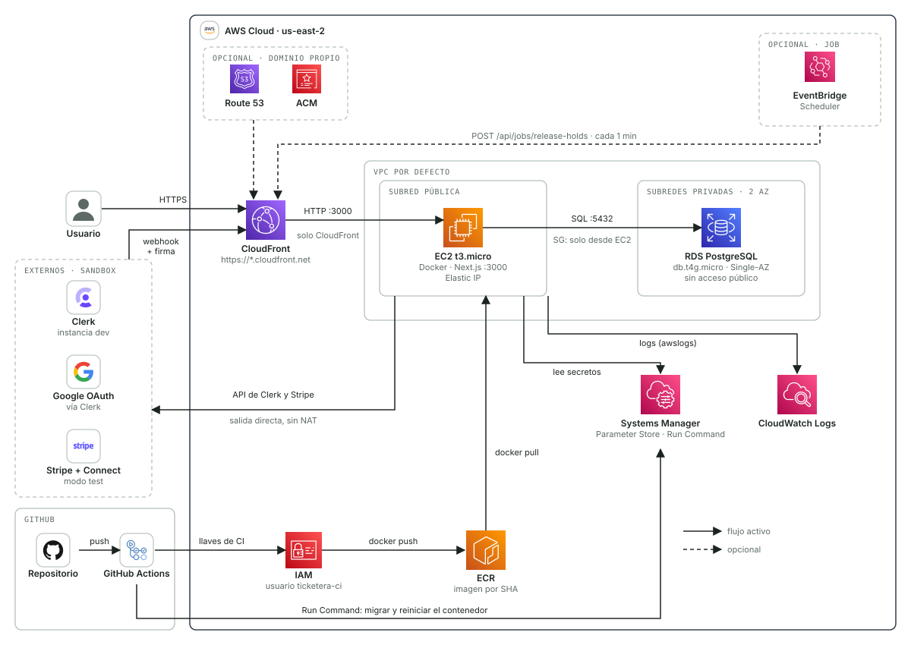

# Arquitectura en AWS (demo) — Ticketera

Estado: desplegado (demo, credenciales sandbox)
Fecha: 2026-10-16
Relacionado: [`system-design.md`](./system-design.md) (arquitectura general), [`erd.md`](./erd.md) (modelo de datos)

URL de la demo: `https://d35ycaybluucd9.cloudfront.net`

## 1. Contexto y restricciones

- **Demo, no producción real.** Credenciales de sandbox: instancia de desarrollo de Clerk (con las credenciales de Google que Clerk comparte en desarrollo) y Stripe en modo test.
- **Presupuesto: US$100 de crédito de AWS, que deben durar unos 3 meses.** Todo servicio con costo fijo relevante se descarta mientras no haga falta.
- **Sin correos** en esta etapa: no hay SES ni alarmas por correo. (Clerk envía sus propios correos de verificación a quien use email y contraseña; no es parte de esta infraestructura.)
- **Sin dominio:** Route 53 y ACM son opcionales. La demo usa la URL `*.cloudfront.net`.
- **Sin balanceador ni WAF** en esta primera etapa.
- **CI/CD con GitHub Actions** al actualizar `main`.

### Restricciones de la cuenta (descubiertas al crear la infra)

La cuenta de AWS ("Building Things") pertenece a una organización de AWS con una política de control de servicios (SCP):

- **Solo se puede usar `us-east-2` (Ohio)** para EC2, RDS, ECR, SSM, Lambda y EventBridge. En las demás regiones probadas esos servicios están denegados.
- **OIDC está denegado** (`iam:CreateOpenIDConnectProvider`), así que GitHub Actions no puede asumir un rol sin llaves.
- **Probablemente no se pueda crear un certificado ACM para CloudFront** (debe vivir en us-east-1). No se probó; un dominio propio con HTTPS en CloudFront podría no ser posible en esta cuenta.
- **El plan gratuito limita RDS:** retención de backups máxima de 1 día.
- Funcionan: CloudFront, S3, IAM (roles y usuarios), CloudWatch Logs, Budgets y Cost Explorer.

## 2. Decisiones

| Tema | Decisión | Por qué |
| --- | --- | --- |
| Región | **us-east-2** | La única donde la SCP permite el cómputo; precios iguales a us-east-1 |
| Entrada | **CloudFront** con la URL `*.cloudfront.net` | HTTPS sin dominio ni balanceador; capa gratuita permanente (1 TB y 10 M de peticiones) |
| Cómputo | **Una EC2 `t3.micro`** con Docker, Elastic IP, VPC por defecto | Costo fijo bajo. El ALB (~US$16/mes) y ECS Express Mode (que crea un balanceador) no entran en el presupuesto |
| Base de datos | **RDS PostgreSQL 17.11** `db.t4g.micro`, Single-AZ, 20 GB gp3, cifrada, sin acceso público | Servicio administrado |
| Secretos y config | **Parameter Store** (`/ticketera/*`, SecureString para secretos) | Gratis; Secrets Manager cuesta US$0,40 por secreto al mes |
| Registro de imágenes | **ECR** `ticketera-app`, conserva las últimas 10 imágenes | 2 imágenes por deploy (`app` y `migrate`) |
| CI/CD | **GitHub Actions** con las llaves del usuario IAM `ticketera-ci` (secretos del repo) y **SSM Run Command** | OIDC bloqueado; sin SSH ni puertos de administración abiertos |
| Job de reservas | **EventBridge Scheduler** llamando a la URL (opcional, no creado) | La disponibilidad ya ignora reservas vencidas |
| Logs | **CloudWatch Logs** `/ticketera/app`, retención 14 días | Dentro de la capa gratuita |

## 3. Diagrama



Los logos de los servicios AWS son los iconos de arquitectura oficiales. El artifact de Claude tiene una versión con costos y estado.

## 4. Recursos creados

| Recurso | Identificador |
| --- | --- |
| EC2 | `<instance-id>` (`ticketera-app`, `t3.micro`, AMI Amazon Linux 2023, volumen 20 GB gp3 cifrado, IMDSv2) |
| Elastic IP | `<elastic-ip>` (`<allocation-id>`) |
| RDS | `ticketera-db` (`<rds-endpoint>`), base `ticketera`, usuario `ticketera` |
| CloudFront | `E3MHN7VMT0323S` (`d35ycaybluucd9.cloudfront.net`), origen = DNS público de la Elastic IP por HTTP :3000 |
| Security groups | `ticketera-app-sg` (`<app-sg-id>`), `ticketera-rds-sg` (`<rds-sg-id>`) |
| ECR | `<account-id>.dkr.ecr.us-east-2.amazonaws.com/ticketera-app` |
| IAM | rol `ticketera-ec2-role` + perfil `ticketera-ec2-profile`; usuario `ticketera-ci` |
| Logs | `/ticketera/app` |
| Budgets | `ticketera-credito-100` (US$100 por trimestre, 50 % y 80 % reales, 100 % pronosticado) y `ticketera-mensual-33` |
| Parameter Store | `/ticketera/*`: variables de la app, `db-password` y `DATABASE_URL` |

Todo lleva la etiqueta `project=ticketera`. Los identificadores concretos (cuenta, instancia, IP, endpoints) no se versionan porque el repositorio es público; se consultan con `aws ec2 describe-instances --filters Name=tag:project,Values=ticketera` y equivalentes, o en las variables del repo (`INSTANCE_ID`, `APP_HOST`).

### Red y seguridad

- **VPC por defecto**; la EC2 está en una subred pública con Elastic IP y sale a internet directo (sin NAT, por eso no se paga uno). RDS usa el grupo de subredes por defecto con `publicly accessible = false`.
- **`ticketera-app-sg`:** entrada TCP 3000 **solo** desde la lista de prefijos de CloudFront (`com.amazonaws.global.cloudfront.origin-facing`). Sin SSH: el acceso administrativo es por SSM.
- **`ticketera-rds-sg`:** entrada TCP 5432 **solo** desde `ticketera-app-sg`.
- **Rol de la instancia:** `AmazonSSMManagedInstanceCore` más políticas pequeñas por tema (`ticketera-ecr-pull`, `ticketera-logs`, `ticketera-params`, `ticketera-kms-decrypt`). IAM rechazaba la política combinada con un error de parseo que no se logró aislar, por eso están divididas. Para `ssm:GetParametersByPath` el recurso es la ruta `parameter/ticketera` además de `parameter/ticketera/*`.
- **Usuario `ticketera-ci`:** solo puede subir a ese repositorio de ECR y ejecutar `ssm:SendCommand` sobre esa instancia con `AWS-RunShellScript`.
- **CloudFront:** comportamiento por defecto sin caché, todos los métodos y política de origen `AllViewer`; `/_next/static/*` con caché optimizada; HTTP se redirige a HTTPS.

## 5. Costos

Aproximado, precios de lista on-demand en us-east-2 (confirmar con la calculadora de AWS). Al 2026-10-16 el gasto acumulado era US$0,00; Cost Explorer tarda en reflejar los recursos nuevos.

| Concepto | USD / mes |
| --- | --- |
| RDS `db.t4g.micro` Single-AZ | 11,68 |
| EC2 `t3.micro` 24/7 | 7,59 |
| IP pública (Elastic IP) | 3,65 |
| Almacenamiento RDS 20 GB gp3 | 2,30 |
| Disco EC2 20 GB gp3 | 1,60 |
| ECR | 0,10 |
| CloudFront, Parameter Store, CloudWatch Logs (<5 GB) | 0,00 |
| **Total** | **≈ 26,92** |

Con US$100 de crédito: **unos 3,7 meses encendido 24/7** (~US$0,9 al día). Si 1 GB de memoria resulta justo y hay que subir a `t3.small` (+US$7,6/mes), el margen de 3 meses casi desaparece.

| Para estirar el crédito | Ahorro | Qué se pierde |
| --- | --- | --- |
| Apagar EC2 y RDS cuando no hay demo | hasta ~US$17/mes | La demo no responde. AWS vuelve a encender RDS solo a los 7 días |
| Postgres en Docker en la misma EC2, sin RDS | ~US$14/mes | Backups administrados y separación de la base |
| Neon (capa gratuita) en vez de RDS | ~US$14/mes | La base queda fuera de AWS |

## 6. CI/CD (GitHub Actions)

Archivo: `.github/workflows/deploy.yml`.

- `pull_request` a `main`: lint y tests.
- `push` a `main`: lint y tests; si pasan, deploy.
- `workflow_dispatch` con el SHA de una imagen: redeploy de esa imagen (rollback), sin reconstruir.

Pasos del deploy:

1. Credenciales de AWS desde los secretos `AWS_ACCESS_KEY_ID` y `AWS_SECRET_ACCESS_KEY` (usuario `ticketera-ci`).
2. Build y push a ECR de dos imágenes con el SHA del commit: la app (`:<sha>`) y la de migración (`:<sha>-migrate`). Los `NEXT_PUBLIC_*` entran como argumentos de build desde variables del repo.
3. SSM Run Command ejecuta `deploy/deploy.sh <sha>` en la instancia (el workflow lo envía en base64, por lo que el script siempre está al día). El script:
   - genera `/opt/ticketera/.env` desde Parameter Store;
   - baja las dos imágenes;
   - ejecuta `npx drizzle-kit migrate` contra RDS en un contenedor de una vez;
   - arranca la app (puerto 3000, log driver `awslogs`) y espera `/api/health`;
   - si no responde, muestra los logs y restaura el contenedor anterior.
4. Prueba de humo por CloudFront: `/api/health` y `/`.

**Secretos del repo:** `AWS_ACCESS_KEY_ID`, `AWS_SECRET_ACCESS_KEY`.
**Variables del repo:** `AWS_REGION`, `ECR_REPO`, `INSTANCE_ID`, `APP_HOST` y los `NEXT_PUBLIC_*` (claves publicables de test y rutas de Clerk).

El concurrency group `deploy-main` evita dos deploys a la vez.

## 7. Variables y secretos (sandbox)

| Variable | Dónde vive | Notas |
| --- | --- | --- |
| `DATABASE_URL` | Parameter Store (SecureString) | `postgresql://ticketera:…@<rds>:5432/ticketera?sslmode=require` |
| `CLERK_SECRET_KEY`, `STRIPE_SECRET_KEY` | Parameter Store (SecureString) | Claves de test |
| `CLERK_WEBHOOK_SIGNING_SECRET`, `STRIPE_WEBHOOK_SECRET`, `STRIPE_CONNECT_WEBHOOK_SECRET` | Parameter Store (SecureString) | **`PENDING`** hasta registrar los webhooks con la URL de CloudFront |
| `NEXT_PUBLIC_*` (Clerk, Stripe) | Parameter Store (String) y variables de GitHub | Los de GitHub se usan al construir la imagen |
| `APP_URL`, `SUPER_ADMIN_EMAIL`, `STRIPE_CONNECT_ACCOUNT_COUNTRY`, `STRIPE_CONNECT_ACCOUNT_CURRENCY` | Parameter Store (String) | |
| `GOOGLE_MAPS_API_KEY` | No se usa | Sin clave, la UI no muestra mapa |

Para cargar un secreto de webhook (no pasa por el chat):

```bash
aws ssm put-parameter --profile ticketera --region us-east-2 \
  --name /ticketera/STRIPE_WEBHOOK_SECRET --type SecureString --value "whsec_..." --overwrite
```

Después hay que volver a desplegar (o reiniciar el contenedor) para que la app lea el valor: Actions → ci-cd → Run workflow con el SHA actual.

URLs de los webhooks: `https://d35ycaybluucd9.cloudfront.net/api/webhooks/clerk`, `/api/webhooks/stripe` y `/api/webhooks/stripe-connect`.

## 8. Cambios hechos en el repo

- **`src/db/index.ts`:** de `neon-http` a `node-postgres` (pool de 5 conexiones). Los servicios usaban `db.batch` (una transacción no interactiva), que `node-postgres` no tiene. Se añadió un `batch` propio que ejecuta las sentencias, en orden, dentro de `BEGIN … COMMIT`, y revierte todo ante cualquier error. Las consultas se enrutan por `AsyncLocalStorage` hacia la conexión de la transacción, de modo que los constructores de Drizzle creados desde `db` se ejecutan dentro de ella y conservan el mapeo de resultados. Los servicios no cambiaron (solo se actualizaron seis comentarios). Se verificó contra un Postgres real: resultados mapeados, `22012` revierte el batch y las consultas fuera del batch no ven la transacción abierta. Los tests unitarios mockean `@/db`, así que no validan este `batch`: la validación real es el flujo de compra en el sitio desplegado.
- **TLS a RDS:** `pg` trata `sslmode=require` como `verify-full`. La imagen incluye el bundle de CA de RDS y lo carga con `NODE_EXTRA_CA_CERTS`, sin deshabilitar la verificación. `pg` imprime una advertencia de seguridad inofensiva sobre el cambio de semántica en la v9.
- **`next.config.ts`:** `output: "standalone"`.
- **`src/app/api/health/route.ts`:** sonda de vida sin autenticación ni acceso a base de datos.
- **`Dockerfile` y `.dockerignore`:** etapas `certs`, `deps`, `build`, `migrate` y `runner` (por defecto), usuario sin privilegios y `HOSTNAME=0.0.0.0`. Tamaño de la imagen ~420 MB. El build no necesita variables del servidor ni base de datos.
- **`drizzle.config.ts`:** `.env` opcional, porque en el contenedor de migración las variables vienen del entorno.
- **`deploy/deploy.sh`** y **`.github/workflows/deploy.yml`** (ver §6).
- **Dependencias:** se añadió `pg` y `@types/pg`; se quitó `@neondatabase/serverless`. Local sigue funcionando con Neon a través de `pg`.

## 9. Limitaciones conocidas y riesgos aceptados

- **Esquema `http` en las redirecciones de Clerk.** CloudFront habla HTTP con el origen y descarta la cabecera `X-Forwarded-Proto` (tanto como cabecera de origen como desde una CloudFront Function). Next y Clerk arman las redirecciones con `http://`; CloudFront las lleva a HTTPS con un 301. Si el login entra en bucle, la salida es un proxy nginx en la instancia que añada la cabecera. No se agregó para no sumar una pieza sin necesidad.
- **Una sola instancia y una sola zona:** si cae, no hay respaldo; RDS tampoco es Multi-AZ. El reinicio del contenedor en cada deploy corta el servicio unos segundos.
- **Sin WAF ni límite de peticiones.** La lista de prefijos de CloudFront es global: cualquier distribución de CloudFront podría llegar al origen.
- **El tramo CloudFront a EC2 va en HTTP.** Aceptable con credenciales sandbox y datos de prueba.
- **Memoria justa:** `t3.micro` tiene 1 GB (más 2 GB de swap). Revisar `free -m`; si no alcanza, `t3.small`.
- **Backups de RDS de 1 día** y sin protección contra borrado (para poder apagarlo).
- **Datos de la demo:** el seed (`src/db/seed.ts`) corrió en RDS el 2026-10-16: 10 eventos publicados, 10 recintos, 50 zonas y 7.160 asientos. Como el seed solo busca organizadores que ya existan, antes se copiaron desde Neon (misma instancia de desarrollo de Clerk) las dos cuentas organizadoras por defecto, con su `clerk_id`, para que el login en AWS caiga en esas filas. Reejecutar el seed es idempotente.

## 10. Qué se quitó y cuándo volver

| Se quitó | Por qué | Volver cuando |
| --- | --- | --- |
| Application Load Balancer | ~US$16/mes aunque no haya tráfico; CloudFront ya da HTTPS | Haya más de una instancia o tráfico real |
| NAT Gateway | ~US$33/mes más datos; la EC2 sale directo | La instancia deba pasar a subred privada |
| WAF | Desde ~US$6/mes; sin datos reales no hace falta | La demo pase a datos reales |
| ECS Express Mode | Crea un balanceador por debajo | Se necesite escalar sin administrar la instancia |
| Secrets Manager | US$0,40 por secreto al mes | Se necesite rotación automática |
| SNS y SES | Sin correos ni alarmas por correo | Se definan notificaciones |
| Lambda del job | EventBridge llama directo a la URL | El job necesite lógica propia |
| OIDC de GitHub | Denegado por la SCP de la organización | La organización lo permita |
| App Runner | Cerrado a clientes nuevos desde el 2026-04-30 | No aplica |

Fuentes sobre App Runner y ECS Express Mode: [aviso de disponibilidad de App Runner](https://docs.aws.amazon.com/apprunner/latest/dg/apprunner-availability-change.html), [anuncio de ECS Express Mode](https://aws.amazon.com/about-aws/whats-new/2025/11/announcing-amazon-ecs-express-mode/).

## 11. Opcionales

- **Dominio propio:** requiere un certificado ACM en us-east-1 (probablemente denegado por la SCP), un dominio y una zona en Route 53 (~US$13/año y ~US$0,50/mes, fuera del presupuesto).
- **Job de reservas:** EventBridge Scheduler (us-east-2) con un destino de API que haga `POST /api/jobs/release-holds` cada minuto con un secreto compartido. Falta crear la ruta en la app.

## 12. Operación

```bash
# Gasto real del mes (cuesta US$0,01 por consulta)
aws ce get-cost-and-usage --profile ticketera --time-period Start=2026-10-01,End=2026-10-31 \
  --granularity MONTHLY --metrics UnblendedCost

# Logs del contenedor
aws logs tail /ticketera/app --profile ticketera --region us-east-2 --follow

# Apagar / encender para ahorrar crédito (la Elastic IP sigue cobrando)
aws ec2 stop-instances  --profile ticketera --region us-east-2 --instance-ids <instance-id>
aws ec2 start-instances --profile ticketera --region us-east-2 --instance-ids <instance-id>
aws rds stop-db-instance  --profile ticketera --region us-east-2 --db-instance-identifier ticketera-db
aws rds start-db-instance --profile ticketera --region us-east-2 --db-instance-identifier ticketera-db
```

Al volver a encender la EC2, el contenedor arranca solo (`--restart unless-stopped`). Rollback: Actions → ci-cd → Run workflow con el SHA anterior.

## 13. Discrepancia con `system-design.md`

`system-design.md` (borrador, no se modifica aquí) define producción en GCP. Este documento lo reemplaza para el despliegue en AWS:

| `system-design.md` | Este documento |
| --- | --- |
| Cloud Run | EC2 con Docker detrás de CloudFront |
| Cloud SQL (`pg` + conector) | RDS PostgreSQL (`pg` dentro de la VPC) |
| Secret Manager | Parameter Store |
| Cloud Scheduler | EventBridge Scheduler (opcional) |
| Job de drizzle-kit antes de cada deploy | Contenedor `migrate` dentro del deploy por SSM |
| Claves live y OAuth propio de Google | Sandbox: claves de test y credenciales de desarrollo de Clerk |

Se mantiene: Clerk, Stripe Connect, reglas de límite entre módulos y webhooks idempotentes. Google Maps no se usa en la demo.

## 14. Pendientes

1. Registrar los tres webhooks (Clerk, Stripe, Stripe Connect) con la URL de CloudFront y cargar sus secretos (§7).
2. ~~Datos de la demo~~ (hecho, ver §9). Para volver a ejecutar el seed en AWS: SSM Run Command en la instancia con `docker run --rm --env-file /opt/ticketera/.env <imagen>-migrate npx tsx src/db/seed.ts`.
3. Verificar un flujo de compra de punta a punta (reserva y pago con tarjeta de prueba): valida el `batch` sobre RDS.
4. Decidir si se activa el job de liberación de reservas.
