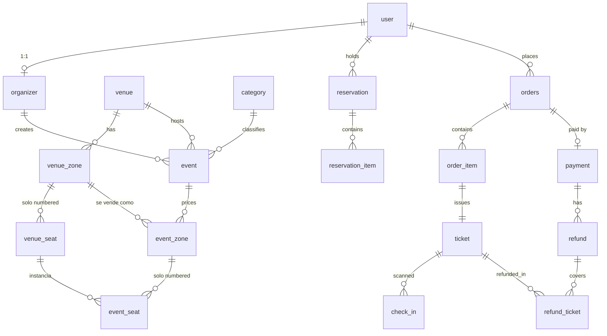

# MER — Ticketera

Estado: borrador (pendiente de revisión humana)
Fecha: 2026-09-30
Relacionado: [`system-design.md`](./system-design.md)

Convenciones: PK `uuid`; dinero en centavos (`*_cents`, entero); `created_at`/`updated_at` en todas las tablas; `snake_case` en inglés. La tabla de pedidos se llama `orders` porque `order` es palabra reservada. Tipos exactos, defaults y FKs se definen en el schema de Drizzle (`src/db`).

## 1. Diagrama

## 2. Enums

| Enum                       | Valores                                                                                   |
| -------------------------- | ----------------------------------------------------------------------------------------- |
| `user_role`                | `super_admin`, `admin`, `organizer`, `customer`                                           |
| `auth_provider`            | `google`, `email` (método con el que se registró el usuario en Clerk)                     |
| `document_type`            | `dni`, `ce`, `passport`                                                                   |
| `organizer_status`         | `pending`, `approved`, `suspended`                                                        |
| `stripe_onboarding_status` | valores según el estado de la cuenta Connected (ej. `not_started`, `pending`, `complete`) |
| `seating_type`             | `numbered`, `general_admission`                                                           |
| `event_status`             | `draft`, `published`, `cancelled`, `finished`                                             |
| `event_seat_status`        | `available`, `held`, `sold`, `blocked`                                                    |
| `reservation_status`       | `active`, `converted`, `expired`, `released`                                              |
| `order_status`             | `pending`, `paid`, `failed`, `cancelled`, `partially_refunded`, `refunded`                |
| `ticket_status`            | `valid`, `used`, `cancelled`, `refunded`                                                  |
| `check_in_result`          | `ok`, `already_used`, `invalid`, `wrong_event`                                            |
| `refund_reason`            | `customer_request`, `event_cancelled`, `admin`                                            |

## 3. Tablas

### Identidad

| Tabla              | Columnas clave                                                                                                                           |
| ------------------ | ---------------------------------------------------------------------------------------------------------------------------------------- |
| `user`             | `clerk_id` UQ, `email` UQ, `full_name`, `avatar_url`, `auth_provider`, `phone`, `document_type`, `document_number`, `role`, `deleted_at` |
| `organizer`        | `user_id` UQ, `business_name`, `tax_id` (RUC), `stripe_account_id`, `stripe_onboarding_status`, `status`                                 |
| `platform_setting` | `key` PK, `value` jsonb (ej. `platform_fee_percent`), `updated_by` (solo `super_admin`)                                                  |

`user` es un espejo local de la identidad de Clerk (sin contraseñas, tokens ni tabla de cuentas OAuth: Google lo gestiona Clerk). `email`, `full_name`, `avatar_url` y `auth_provider` se sincronizan por webhook; `role` nace en `customer`. `phone`, `document_type` y `document_number` son nullable porque Google no los entrega; se completan en el checkout.

### Recinto

| Tabla        | Columnas clave                                                                                                    |
| ------------ | ----------------------------------------------------------------------------------------------------------------- |
| `venue`      | `name`, `address`, `city`, `lat`, `lng`, `google_place_id`                                                        |
| `venue_zone` | `venue_id`, `name`, `seating_type`, `capacity` (solo GA), `map_shape` jsonb (polígono SVG), `color`, `sort_order` |
| `venue_seat` | `venue_zone_id`, `row_label`, `seat_number`, `x`, `y`; UQ(`venue_zone_id`, `row_label`, `seat_number`)            |

`venue_seat` existe solo para zonas `numbered`. `capacity` se usa solo en zonas `general_admission`.

### Evento

| Tabla        | Columnas clave                                                                                                                                                                                          |
| ------------ | ------------------------------------------------------------------------------------------------------------------------------------------------------------------------------------------------------- |
| `category`   | `slug` UQ, `label`, `icon`                                                                                                                                                                              |
| `event`      | `organizer_id`, `venue_id`, `category_id`, `title`, `slug` UQ, `description`, `cover_image_url`, `cover_alt`, `starts_at`, `doors_open_at`, `min_age`, `status`, `featured`, `currency` (default `PEN`) |
| `event_zone` | `event_id`, `venue_zone_id`, `name`, `price_cents`, `max_per_order`; GA: `capacity`, `sold_count`, `held_count`; UQ(`event_id`, `venue_zone_id`); CHECK `sold_count + held_count <= capacity`           |
| `event_seat` | `event_zone_id`, `venue_seat_id`, `status`; UQ(`event_zone_id`, `venue_seat_id`)                                                                                                                        |

`event_seat` se genera al publicar el evento, solo para zonas `numbered`. "Agotado" y "Últimas entradas" se derivan de disponibilidad, no se almacenan.

### Reserva

| Tabla              | Columnas clave                                                              |
| ------------------ | --------------------------------------------------------------------------- |
| `reservation`      | `user_id`, `event_id`, `status`, `expires_at`                               |
| `reservation_item` | `reservation_id`, `event_zone_id`, `event_seat_id` (null si GA), `quantity` |

### Compra y pago

| Tabla          | Columnas clave                                                                                                                                                                                                                                                                                     |
| -------------- | -------------------------------------------------------------------------------------------------------------------------------------------------------------------------------------------------------------------------------------------------------------------------------------------------- |
| `orders`       | `code` UQ (ej. `TK-24817`), `user_id` NOT NULL, `event_id`, `reservation_id`, `status`, `subtotal_cents`, `platform_fee_cents`, `total_cents`, snapshot del comprador (`buyer_name`, `buyer_email`, `buyer_document_type`, `buyer_document_number`, `buyer_phone`), `terms_accepted_at`, `paid_at` |
| `order_item`   | `order_id`, `event_zone_id`, `event_seat_id` (null si GA), `unit_price_cents`                                                                                                                                                                                                                      |
| `payment`      | `order_id`, `stripe_payment_intent_id` UQ, `stripe_charge_id`, `status`, `amount_cents`, `application_fee_cents`, `destination_account_id`                                                                                                                                                         |
| `stripe_event` | `id` PK (id del evento de Stripe), `type`, `processed_at` — idempotencia de webhooks                                                                                                                                                                                                               |

### Entrada y check-in

| Tabla      | Columnas clave                                                                                     |
| ---------- | -------------------------------------------------------------------------------------------------- |
| `ticket`   | `order_item_id` UQ, `event_id`, `holder_name`, `code` UQ (token del QR), `status`, `checked_in_at` |
| `check_in` | `ticket_id`, `scanned_by` (user), `scanned_at`, `result`                                           |

### Reembolso

| Tabla           | Columnas clave                                                                                             |
| --------------- | ---------------------------------------------------------------------------------------------------------- |
| `refund`        | `payment_id`, `order_id`, `amount_cents`, `reason`, `status`, `stripe_refund_id` UQ, `requested_by` (user) |
| `refund_ticket` | `refund_id`, `ticket_id`; PK compuesta                                                                     |

## 4. Invariantes garantizadas por la DB

- **Asiento numerado:** `UPDATE event_seat SET status='held' WHERE id=? AND status='available'`. Si afecta 0 filas, el asiento ya no está disponible.
- **Zona de pie (GA):** `UPDATE event_zone SET held_count = held_count + n WHERE sold_count + held_count + n <= capacity`. El CHECK es la red de seguridad.
- **Liberación:** el job marca `reservation` vencidas como `expired`, devuelve los asientos a `available` y baja `held_count`. No hay tabla `seat_hold`: el estado vive en `event_seat`.
- **Check-in idempotente:** `ticket.status='used'` se fija con `UPDATE ... WHERE status='valid'`. Un segundo escaneo registra `already_used` en `check_in`.
- **Un ticket por ítem:** `ticket.order_item_id` es UQ. `order_item` de asiento numerado apunta a un `event_seat` único vendido una sola vez.
- **Webhooks idempotentes:** `stripe_event.id` PK impide procesar dos veces el mismo evento; `stripe_refund_id` y `stripe_payment_intent_id` son UQ.
- **Cancelar evento:** `event.status='cancelled'` genera un `refund` (`event_cancelled`) por cada `payment` pagado.

## 5. Índices recomendados

- `event(status, starts_at)`
- `event(category_id)`, `venue(city)` para la búsqueda por ciudad y categoría
- `event_seat(event_zone_id, status)`
- `reservation(status, expires_at)`
- `orders(user_id, created_at)`
- `ticket(event_id, status)`

## 6. Supuestos

- El checkout exige sesión (`orders.user_id` NOT NULL).
- Una `reservation` pertenece a un solo evento.
- La ciudad se lee de `venue.city`, sin duplicarla en `event`.
- Google OAuth no agrega tablas: solo `user.auth_provider` y `user.avatar_url`. Si luego se cambia Clerk por Auth.js, harían falta tablas `account`/`session`.
- Quién crea `venue` está pendiente (ver `system-design.md`, sección 6).
